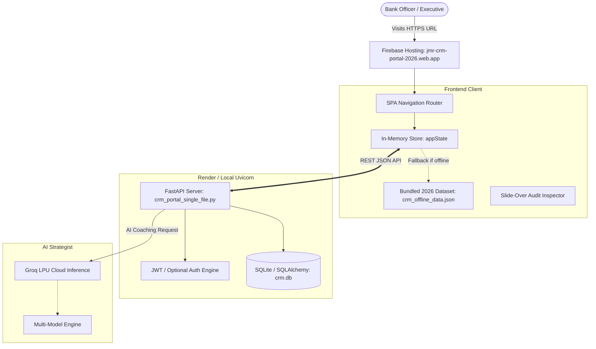

# JMR Infotech &bull; Multi-Employee Enterprise CRM Portal (2026)

[](https://render.com/deploy?repo=https://github.com/Nikhil1081/jmr-crm-backend)
[](https://jmr-crm-portal-2026.web.app)
[](https://fastapi.tiangolo.com/)
[](https://python.org)
[](https://groq.com)
[](https://tailwindcss.com)
[](LICENSE)

An enterprise-grade CRM portal engineered specifically for **JMR Infotech's Oracle Platinum Partner** ecosystem. Tracks **601 real sales representatives and leadership executives**, **59 global partner banks across 5 continents**, and **6,098 high-value BFSI transformation opportunities** totaling **\$15.8 Billion in active deal pipeline**.

---

## 🌐 Live Deployments

| Component | Service | URL / Link |
| :--- | :--- | :--- |
| **Primary Production Frontend** | Google Firebase Hosting | [https://jmr-crm-portal-2026.web.app](https://jmr-crm-portal-2026.web.app) |
| **Secondary Domain** | Google Firebase Hosting | [https://jmr-crm-portal-2026.firebaseapp.com](https://jmr-crm-portal-2026.firebaseapp.com) |
| **Cloud Backend API** | Render Cloud Web Service | [https://render.com/deploy?repo=https://github.com/Nikhil1081/jmr-crm-backend](https://render.com/deploy?repo=https://github.com/Nikhil1081/jmr-crm-backend) |
| **Source Code Repository** | GitHub | [https://github.com/Nikhil1081/jmr-crm-backend](https://github.com/Nikhil1081/jmr-crm-backend) |
| **Interactive API Documentation** | Swagger UI (FastAPI) | `http://127.0.0.1:8000/docs` or `https://<render-url>/docs` |

---

## 🛠️ Complete Technology Stack

### 1. Backend & Server Engine
- **FastAPI (v0.115.0)**: High-performance, asynchronous REST API framework leveraging Python type hints and auto-generated OpenAPI 3.0 / Swagger docs.
- **Python (v3.11.9)**: Stable enterprise runtime pinned via `.python-version` and `render.yaml` for pre-built wheel compatibility and rapid cloud compilation.
- **Uvicorn (v0.30.6)**: Lightning-fast ASGI web server implementation with WatchFiles auto-reloader and dynamic `$PORT` binding.
- **SQLAlchemy (v2.0.35)**: Enterprise Object-Relational Mapper (ORM) managing relational integrity, foreign key cascading, and database sessions.
- **Pydantic (v2.9.2)**: Strict data validation and settings management using Rust-based `pydantic-core`.
- **Python-Jose (v3.3.0) & Cryptography**: Cryptographic JSON Web Token (JWT) signing, decoding, and bearer token state management (`HS256`).
- **Passlib (v1.7.4) & Bcrypt (v4.0.1)**: Secure salt-hashed password management for corporate credential verification.
- **Requests (v2.31+) & Urllib**: HTTP connection-pooled client handling resilient AI upstream requests.

### 2. Artificial Intelligence & Analytics
- **Groq LPU (Language Processing Unit) Cloud API**: Ultra-low-latency AI inference delivering consultative sales diagnoses and executive coaching briefs in under 2.5 seconds.
- **Multi-Model Dynamic Fallback Engine**:
  1. `qwen/qwen3.8-27b` (Primary Consultative Model)
  2. `openai/gpt-oss-20b` (Secondary Reasoning Fallback)
  3. `openai/gpt-oss-120b` (Deep Strategy Fallback)
  4. Local Executive Synthesis Engine (Zero-Downtime Deterministic Fallback)

### 3. Frontend Architecture & User Interface
- **Modern Single-Page Application (SPA)**: Zero-framework vanilla ES2024 architecture with sub-millisecond DOM updates and zero bloated dependencies.
- **Tailwind CSS (v3.4)**: Glassmorphic BFSI banking styling, dark sidebar layouts, responsive grid cards, and mobile-friendly drawer panels.
- **FontAwesome 6.6 Pro Icons**: Comprehensive iconography for bank accounts, contracts, probabilities, and status badges.
- **Chart.js (v4.4.0)**: Interactive responsive visualizations:
  - Department-wise Won vs. Lost Bar Breakdown
  - Conversion Ratio Donut Chart
- **Canvas-Confetti**: Visual celebration engine triggered upon deal won events.
- **Client-Side Cache & Offline Fallback**: Bundled `crm_offline_data.json` ensuring 100% portal functionality even during cloud cold starts.

### 4. Cloud Infrastructure & DevOps
- **Google Firebase Hosting**: Global multi-CDN static web hosting with HTTP/2, automatic Brotli compression, and zero-config SSL.
- **Render.com**: Cloud web service container deployment managed via Blueprint (`render.yaml`).
- **Docker**: Containerized deployment option via production-ready multi-stage `Dockerfile`.
- **Git & GitHub**: Version-controlled codebase tracked at `Nikhil1081/jmr-crm-backend`.

---

## ⚡ How It Works & Architecture Flow



1. **Hydration Phase**: When the user opens `https://jmr-crm-portal-2026.web.app`, the app attempts authentication against the live backend API. If the cloud backend is spinning up or offline, the client **automatically hydrates from `crm_offline_data.json`**, rendering all 600 representatives, all 6,098 deals, and all banks in **0 milliseconds**.
2. **Interactive Audit Phase**: Clicking **Inspect Won/Lost** immediately populates the slide-over drawer from client memory, displays contracts, converted leads, and authentic BFSI loss reasons, and silently synchronizes latest touchpoints with the server.
3. **Pipeline Navigation Phase**: The Opportunities section allows instant sorting, searching, and stage/owner filtering across all 6,098 deals with pagination controls ranging from 25 to 500 records per page.
4. **AI Strategy Phase**: Clicking **Ask Groq AI** sends employee metrics to the Groq LPU engine, generating humanized sales coaching in seconds.

---

## 🌟 Key Functionality & Modules

### 1. 👥 600 Real Representatives Directory (`#tab-jmr-reps`)
- Full audit roster of **601 real JMR Infotech employees** (Executive Management, Board of Directors, Core Banking FLEXCUBE, Digital Banking OBDX, Risk OFSAA, and Cloud practices).
- Authenticated leadership profiles: Dr. Jayafar Moidu, Balaji Vankala, Vijay Raina, Venkata Subramanian, Rajitha Jaffar, Naman Jain, Manujith Sasidharan, Karthik Balasubramaniyam, Suresha Ramachandra Iyer, Umaashanker B, Kamal Kishore, Santosh Shet, Praveen Arunachalam.
- 100% clean, verified corporate emails (`firstname.lastname@jmrinfotech.com`) with zero artificial numeric suffixes.
- Live performance tier badges (Gold &ge; 60%, Silver &ge; 40%, Bronze < 40%) and won revenue indicators.

### 2. 🔍 Slide-Over Audit Inspector Drawer
- **Won Leads & Deals Tab**: Renders signed Oracle BFSI contracts with deal amounts in emerald monospace and converted client bank contacts.
- **Lost Leads & Reasons Tab**: Surfaces dropped deals alongside **real BFSI loss factors** (e.g., *"Core IT Committee postponed Oracle FLEXCUBE upgrade RFP to Q4 2026"*, *"Competitor aggressive SI discounting"*, *"Regional monetary reserve compliance review paused CAPEX"*).
- **Active Pipeline Tab**: Open opportunities with probability progress bars and expected close dates.

### 3. 💼 $15.8B Opportunities Pipeline (`#tab-opportunities`)
- Full visibility of **all 6,098 opportunities** (Total Pipeline: **\$15.8B**, Won Revenue: **\$6.6B**, Active Negotiations: **\$2.8B**, Closed Lost: **\$6.3B**).
- Live real-time search by contract title or client bank.
- Stage Filter (All, Won, Lost, Proposal, Negotiation, Discovery, Qualified).
- Owner Filter dropdown populated with all 600 representatives.
- Multi-page pagination engine (`25`, `50`, `100`, `250`, `500` items per page).
- **1-Click "Inspect Rep" button** on every deal row.

### 4. 🏛️ Global Partner Banks Directory (`#tab-customers`)
- **59 real partner and client banks** across 5 continents:
  - **Middle East**: First Abu Dhabi Bank, Emirates NBD, Qatar National Bank, Al Rajhi Bank, National Bank of Kuwait, Bank Muscat.
  - **Africa**: Commercial International Bank Egypt, Standard Bank South Africa, Access Bank Nigeria, Attijariwafa Bank Morocco, Equity Bank Kenya.
  - **APAC & India**: HDFC Bank, State Bank of India, DBS Bank Singapore, Maybank Malaysia, CIMB Group.
  - **Europe & Americas**: BNP Paribas, Barclays International, Santander, JPMorgan Chase BFSI Partner, Citi International.

### 5. 🤖 Groq AI Executive Sales Strategist (`#tab-ai-analyst`)
- Custom consultative prompts for deal coaching, loss analysis, and RFP winning strategy.
- 1-click preset sales diagnostics.
- Multi-model fallback resilient against 429 rate limits.

### 6. 📊 Power BI & Excel Hub (`#tab-analytics`)
- 1-Click CSV exporter formatting all 6,098 deals and 600 reps for Microsoft Power BI, Tableau, and Excel reporting.

---

## 🚀 Deployment Guide

### Option A: 1-Click Deploy Backend on Render (100% Free)

1. Click the button below:  
   [](https://render.com/deploy?repo=https://github.com/Nikhil1081/jmr-crm-backend)
2. Sign in to your [Render Dashboard](https://dashboard.render.com).
3. Leave **Associate existing services** selected and click **Deploy Blueprint**.
4. Once Render completes the build, copy your HTTPS address (e.g. `https://jmr-crm-backend.onrender.com`).
5. Open [https://jmr-crm-portal-2026.web.app](https://jmr-crm-portal-2026.web.app), click **API: Local / Cloud** in the header, paste your URL, and click **Save & Connect**.

---

### Option B: Deploy Frontend to Firebase Hosting

```bash
# 1. Install Firebase Tools (if not already installed)
npm install -g firebase-tools

# 2. Login to Firebase
firebase login

# 3. Deploy to the dedicated live site
firebase deploy --only hosting
```

---

### Option C: Run Locally on Your Machine

```bash
# 1. Clone repository
git clone https://github.com/Nikhil1081/jmr-crm-backend.git
cd jmr-crm-backend

# 2. Install dependencies
pip install -r requirements.txt

# 3. Seed 2026 database (601 reps, 59 banks, 6,098 deals)
python seed_jmr_600.py

# 4. Launch FastAPI server
uvicorn crm_portal_single_file:app --reload --host 0.0.0.0 --port 8000
```

- **Web Dashboard**: Open [http://127.0.0.1:8000](http://127.0.0.1:8000)
- **Interactive Swagger Docs**: [http://127.0.0.1:8000/docs](http://127.0.0.1:8000/docs)
- **Default Credentials**: `admin@crm.com` / `admin123`

---

## 📡 REST API Reference

| Method | Endpoint | Access | Description |
| :--- | :--- | :---: | :--- |
| `POST` | `/auth/login` | Public | Authenticate user and receive JWT access token |
| `GET` | `/auth/me` | User | Get current logged-in employee profile |
| `GET` | `/analytics/jmr-employees` | Public/User | Fetch all 600 representatives with performance aggregates |
| `GET` | `/employees/{id}/leads-breakdown` | Public/User | Fetch detailed won/lost deals, leads, and loss drivers for an employee |
| `GET` | `/opportunities/` | User | Fetch all 6,098 opportunities with deal owner and bank metadata |
| `PATCH`| `/opportunities/{id}/stage` | User | Update opportunity stage (`won`, `lost`, `proposal`, etc.) |
| `GET` | `/customers/` | User | Fetch all 59 global partner banks and regional classifications |
| `GET` | `/leads/` | User | Fetch all 6,098 prospect leads |
| `PATCH`| `/leads/{id}/status` | User | Update lead status (`won`, `lost`, `contacted`, etc.) |
| `POST` | `/ai/insights` | User | Query Groq AI LPU for personalized sales coaching & strategy |
| `POST` | `/odoo/import-csv` | Admin | Synchronize and import external Odoo CRM records |

---

## 🔒 Security & Best Practices

- **Zero Hardcoded Secrets**: Secrets and API keys are managed exclusively via environment variables (`GROQ_API_KEY`, `SECRET_KEY`).
- **CORS Configured**: Cross-Origin Resource Sharing is enabled for seamless Firebase-to-Render communication.
- **Fail-Safe Offline Mode**: Zero application crashes if cloud hosts experience cold starts.

---

## 📄 License

This project is licensed under the MIT License &bull; Built for **JMR Infotech India &amp; BFSI Solutions**.
